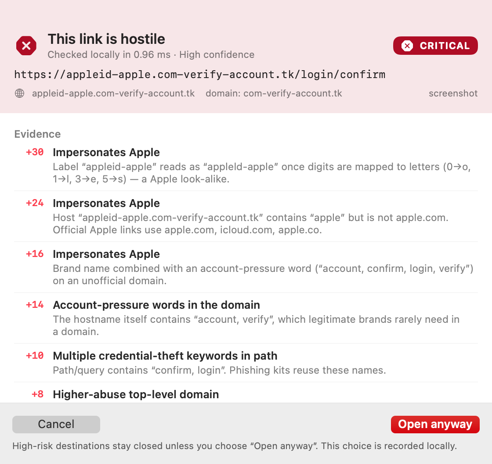

# ScamShield

A local-first macOS link firewall. ScamShield registers as the system **http/https handler**, so when you click a link in WhatsApp, Mail, Slack, Discord or any app that asks macOS to open it, the link is delivered to ScamShield *before any browser loads it*. A decision window explains the evidence; suspicious destinations stay closed until you explicitly choose otherwise.



## Why this architecture

macOS does not expose a public "intercept every link" API. The only supported, non-invasive middle layer is the **default web browser role**:

1. The app bundle declares `http`/`https` in `CFBundleURLTypes` and claims the `com.apple.default-app.web-browser` UTI.
2. The user consents — in the app or in System Settings — to make it the default browser. macOS then routes every LaunchServices link open to it as an Apple Event (`application(_:open:)`).
3. ScamShield scans, shows the window, and only on approval calls `NSWorkspace.open([url], withApplicationAt: browser, …)`, naming the real browser explicitly.

Because the handoff names a specific application, the system default handler (ScamShield) is bypassed — that is the structural reason an approved link cannot loop back into the decision window.

A feasibility probe on this machine confirmed the mechanism before the product was built; see [docs/FEASIBILITY.md](docs/FEASIBILITY.md).

## What is actually verified

| Claim | Evidence |
|---|---|
| ScamShield can become the macOS default web handler | `scripts/real-world-test.sh` → handler verified by LaunchServices |
| A system link open is intercepted before any browser | decision window logged, zero new browser processes while pending |
| Cancel keeps the destination closed | real-world test + in-app integration test |
| Explicit bypass opens the intended URL | exact URL delivered; Opera GX launched |
| Handoff delivers the exact URL to the chosen app | `scripts/integration-test.sh` with a stub browser that logs its input |
| Scanner results are deterministic and explainable | 93 Swift tests, 32/32 fixtures, precision/recall 1.00, 0 false positives |
| Extension API works | curl: `/health`, 401 without token, authorized `/scan` (returns CRITICAL, `block: true`), `/heartbeat` |
| Browser extension blocks in a real browser | `./scripts/extension-test.sh` — MV3 extension loaded into an isolated Chromium profile: benign page loaded untouched, hostile URL replaced by the block page showing CRITICAL, repeat visits stopped pre-load by a declarativeNetRequest rule, heartbeat seen by the app |
| WhatsApp → ScamShield → Opera GX | **Not driven through WhatsApp's UI.** WhatsApp is installed; the LaunchServices path it uses for external links is what was tested with `open`. |

The app itself reports this honestly: **Protected** is only shown when the handler is verified, the scanner self-test passes, a browser is available *and* a browser extension has actually reported in. Otherwise you see Partially protected, Setup required, Unverified, Disabled or Error.

## Quick start

Requirements: macOS 13+, Xcode command line tools (Swift 6 toolchain), no third-party packages, no admin rights.

```bash
cd /path/to/this/workspace
./scripts/build-app.sh     # builds dist/ScamShield.app, ad-hoc signs, registers with LaunchServices
./scripts/run.sh           # launches, waits for the scanner API, prints handler status
```

`./scripts/run.sh` is the recommended way to start it. It builds if needed, verifies that the scanner API answers (port `47613`, or the next free port if that one is taken — the fallback is saved so the extension popup agrees), and prints which app currently owns http/https. Launching never changes your default browser; only the button in the app (or System Settings) does that. Two copies cannot run at once.

Then, in the ScamShield window:

1. **Enable link interception** — this asks macOS to make ScamShield the default web browser. Nothing is changed silently, and macOS only grants the role to the app that requests it.
2. Pick the browser that approved links should open in (Opera GX is preselected when installed).
3. Optionally load the browser extension for in-browser coverage.

Stop it:

```bash
./scripts/stop.sh
```

Install to `~/Applications` (optional, keeps the bundle in a stable place):

```bash
./scripts/install.sh
```

Remove it, restoring a real browser first:

```bash
./scripts/uninstall.sh            # keeps history
./scripts/uninstall.sh --purge    # also deletes local data
```

## Turning it off (important)

macOS only lets an app make *itself* the default browser. It refuses programmatic requests to point the setting at a **different** app (`NSCocoaErrorDomain 256`), so ScamShield cannot switch you back automatically — that is a system security property, not a bug here. Two sanctioned ways out:

- **System Settings → Desktop & Dock → Default web browser** → choose your browser. The app has a button that opens this pane.
- **`./scripts/restore-browser.sh com.operasoftware.OperaGX`** — explicit operator recovery for when the UI is not reachable. It rewrites the LaunchServices handler records and restarts `lsd`.

`./scripts/uninstall.sh` performs the same recovery before removing the app.

## Coverage — what is and is not protected

| Route | Coverage |
|---|---|
| Links clicked in Mail, WhatsApp, Slack, Discord, Telegram, Messages, terminal `open`, QR apps | **Covered** while ScamShield is the default handler — the link is held until you decide |
| Links clicked inside Chrome / Opera GX | **Partial** — only while the ScamShield extension is connected. Known-bad hosts are redirected to a warning page by a `declarativeNetRequest` rule *before* the page loads; unseen URLs are checked on `webNavigation.onBeforeNavigate` and the tab is replaced with the warning page (best effort — Chrome has already started the request) |
| Safari | **Not covered** — a Safari Web Extension needs a signed Xcode app extension; this build ships none. See [docs/SAFARI.md](docs/SAFARI.md) |
| In-app webviews (pages rendered inside an app's own window) | **Never covered** — these never ask macOS to open a URL, so no system handler can see them |
| Typed URLs, bookmarks, dragged links | **Not covered at system level**; pre-checked only inside a browser with the extension connected |
| Download files behind a link | The link is checked, the file is not |

The Protection Center shows this matrix live, with per-route status, so the app never claims more than it has.

## Scanning engine

The core engine is local and deterministic. Bounded live inspection is on by default for manual scans and intercepted links (it can be switched off in Settings) and adds evidence through the same scoring function; it never replaces the local result.

- **URL/domain**: punycode decoding, mixed-script (homograph) detection, Cyrillic/Greek confusables, digit-for-letter substitutions (`paypa1`, `m1crosoft`, `amaz0n`), typo distance, brand-token impersonation across 45 brands, subdomain-only brand tricks, userinfo `@` deception, IP-literal hosts, unusual ports, excessive subdomains, hyphens, elevated-abuse TLDs, shorteners, dangerous file extensions, credential keywords, embedded/open-redirect destinations (analysed one level deep), double encoding, invisible/bidi characters. Machine-generated infrastructure is reported as weak context: character entropy, consonant-only labels, digit-stuffed or hex/UUID subdomains, fake public-suffix labels parked in subdomains, embedded IPs and opaque base64-like path blobs. None of these alone bans a hosting provider, shortener, TLD or HTTP URL.
- **Context**: localhost, private ranges and link-local addresses are handled as context, not threats — a local dev server is not "malicious", but it is also not internet-verified.
- **Messages**: urgency, threats, OTP/password requests, remote-access tools, payment rails, credential harvesting, secrecy, fake authority, delivery/customs lures, investment pitches; embedded links are scanned and the worst one drives the verdict.
- **Email**: From vs Reply-To/Return-Path domain mismatch, display-name spoofing, address-inside-display-name, freemail brand senders, SPF/DKIM/DMARC failures when `Authentication-Results` is present (never guessed when absent).
- **QR codes**: Vision barcode decoding → payload scanned as a URL or message.
- **Screenshots**: Vision on-device OCR → text + links analysed, with confidence and explicit OCR limitations (no logo/pixel forensics).
- **Ephemeral infrastructure**: known tunnelling and dynamic-DNS providers (LocalXpose, ngrok, Cloudflare Quick Tunnel, localtunnel, DuckDNS, No-IP, wildcard DNS) are recognised as *temporary, unverifiable* destinations. This is positive evidence — a random `*.loclx.io` endpoint cannot be shown as LOW RISK just because no brand or keyword matched — but it is not a domain-wide ban, and the provider's own domain stays low risk.
- **Live checks (on by default, disableable)**: VirusTotal, Google Safe Browsing and keyless URLhaus reputation; redirect tracing; page HTML inspection (forms, cross-site form actions, high-value SSN/OTP/PIN/seed inputs, hidden iframes, brand claims, pressure language, script patterns, tracker hosts). A form posting between subdomains of the same registrable domain is treated as same-site, reducing false positives without ignoring genuine cross-domain credential posts. Interception shows the fast structural result immediately and upgrades it in place when page evidence arrives; “wait before showing the window” is a separate opt-in. Every outbound request goes through the SSRF-hardened client described below.

Third-party source attribution and the licence notice for the adapted PhishLens algorithms are in [THIRD-PARTY-NOTICES.md](THIRD-PARTY-NOTICES.md), and the app bundle includes the same notice under `Contents/Resources/`.

Each result carries a score, per-signal evidence with weights, confidence, limitations, structured checks (passed / skipped / unavailable / failed), evidence sources and a recommended action. A failed, timed-out or unavailable scan renders **UNVERIFIED** or **INCONCLUSIVE** and can never be shown as safe. A missing provider answer is never a clean answer.

### Safe outbound requests

`SafeNetwork.swift` enforces: http/https only, ports 80/443/8080/8443 only, loopback/private/link-local/CGNAT/reserved/cloud-metadata addresses rejected after DNS resolution, every redirect re-validated (max 5), 8–20 s timeouts, 512 KB response cap, no cookies, no cache, no TLS-verification bypass. Pages are parsed as untrusted bytes; JavaScript is never executed, forms are never submitted, and no file is ever executed or uploaded.

## Security toolkit

The sidebar is organised into **Protection**, **Investigation**, **Account Security**, **Privacy** and **Workspace**:

- **Protection** — Link & Message Scanner, Website Safety Checker (forms, brand claims, third-party references), Download Safety Checker (signature + extension mismatch + hashes), QR/screenshot scanning via Vision.
- **Investigation** — Domain Inspector (Cloudflare DNS-over-HTTPS + RDAP registration), IP Reputation Checker (scope + reverse DNS + optional VirusTotal), Redirect Tracker, Email Header Analyzer (SPF/DKIM/DMARC only when supplied), File Hash Checker (SHA-256/MD5 locally), Security Headers Checker, Brand Impersonation Checker.
- **Account Security** — Have I Been Pwned breach lookup (requires a paid key), local password-strength evaluation, k-anonymity password breach check (only the first five SHA-1 characters leave the Mac), and an Account Security Guide.
- **Privacy** — Tracker Inspector (hosts referenced in markup, not a live request log), Permission & Privacy Audit (honest about macOS API limits, with deep links to System Settings), Incident Response Center.
- **Workspace** — History & Reports (search, filters, CSV export), Scam Lab, Evaluation, Settings.

Every tool states what it measured, which providers were contacted, what it could not establish, and a safe next step. Tools that need a key say so instead of returning a fake clean result.

## Browser extensions

Chromium MV3 extension for Chrome and Opera GX is in [extensions/chrome](extensions/chrome). It talks to the local API with a per-install token shown in ScamShield → Settings → Extension API. Setup: [docs/EXTENSION.md](docs/EXTENSION.md).

## Project layout

```
Package.swift                 SwiftPM: core library, app, CLI, tests
Sources/ScamShieldCore/       scanner engine, storage, intel graph, fixtures, media
Sources/ScamShield/           AppKit/SwiftUI app: interception, decision window, dashboard, local API
Sources/scamshieldctl/        CLI scanner (scan-url, scan-text, scan-email, eval, selftest, handler-status)
extensions/chrome/            Chrome / Opera GX MV3 extension
scripts/                      build, run, stop, install, uninstall, doctor, tests (Swift + extension), recovery
Resources/Info.plist          bundle declaration (http/https + web-browser UTI)
docs/                         feasibility, coverage, test report, extension, Safari and landing-page inspection notes
```

## Testing

```bash
swift test                          # 119 unit/integration tests: engine, storage, security, phishing-page, landing-page, Gemini discovery/selection and AI-validation regressions
./scripts/integration-test.sh       # real app: delivery → scan → window → cancel/approve → stub browser
./scripts/real-world-test.sh        # real system handler: open → intercept → cancel / approve → Opera GX
./scripts/doctor.sh                 # environment + installation diagnostics
./dist/ScamShield.app/Contents/MacOS/scamshieldctl eval   # fixture metrics

# Optional: exercise the browser extension in a throwaway Chromium profile
# (needs the app running; playwright-core is installed to ~/Library/Caches, not the project)
./scripts/extension-test.sh
```

`real-world-test.sh` changes your default browser for the duration of the test and restores it afterwards. Results of the last run: [docs/TEST-REPORT.md](docs/TEST-REPORT.md).

## Privacy

History, settings, allowlist and the API token (mode 600) are stored under `~/Library/Application Support/ScamShield/`. Provider API keys are stored as generic passwords in the macOS login Keychain and are never written to settings.json, logs or exports. Manual and intercepted URL scans fetch the destination HTML once by default (bounded to 512 KB); the URL/domain may also be sent to the providers you configured (VirusTotal, Google Safe Browsing, URLhaus, Cloudflare DoH, rdap.org, HIBP). Disable live checks for structural-only scanning. No images, passwords, keystrokes or full files are ever uploaded. Password breach checks send only the first five characters of a SHA-1 hash. Keys are shown only as “configured” and never logged. There is no analytics or telemetry.

A failed, timed-out, rate-limited or unconfigured provider adds a limitation and a failed/skipped check — never a clean result or an automatic LOW RISK verdict.

## API configuration

All providers are optional. Configure them in **Settings → Reputation providers / Account security**.

| Provider | What it needs | What is sent | Notes |
|---|---|---|---|
| VirusTotal | Free v3 API key | A URL-safe base64 URL identifier; for files, only the SHA-256 hash | Free tier is ~4 requests/minute; HTTP 429 is reported as a failure |
| Google Safe Browsing | Google Cloud API key with Safe Browsing v4 enabled | The full URL being checked | Reports matches only; no match is not proof of safety |
| URLhaus (abuse.ch) | Nothing — enabled by default | The full URL being checked | Public malware-URL feed; can be switched off |
| Cloudflare DNS-over-HTTPS | Nothing | The domain name | Used by Domain Inspector |
| RDAP (rdap.org) | Nothing | The registrable domain | Registration dates/registrar where published |
| Have I Been Pwned | Paid HIBP v3 API key | The email address | Ask HIBP about key availability; the free key does not cover breach lookups |
| Pwned Passwords | Nothing | First five characters of the SHA-1 hash | k-anonymity; the password never leaves the Mac |
| AI analysis / explanation | Gemini or OpenAI-compatible provider, model and key (Keychain) | Bounded deterministic evidence plus a short plain-text page excerpt; never raw HTML, passwords or files | Gemini models are discovered from the key, filtered to text generation, and probed with a real request before being saved; a model list or saved key alone is not "Connected". Analysis is off by default and independent of Test Connection. Validated findings can add corroborating evidence but can never erase deterministic evidence or lower a verdict. Commentary is separate and never changes the verdict. |

Gemini setup, discovery, fallback and error meanings:
[docs/GEMINI-INTEGRATION.md](docs/GEMINI-INTEGRATION.md).

## Operator / testing commands

These exist for verification and recovery, and are safe to ignore in normal use:

```bash
ScamShield.app/Contents/MacOS/ScamShield --make-default          # claim the web handler, print verification
ScamShield.app/Contents/MacOS/ScamShield --restore-default <id>  # attempt (macOS usually refuses; see above)
ScamShield.app/Contents/MacOS/ScamShield --integration-test      # full pipeline with a stub browser
ScamShield.app/Contents/MacOS/ScamShield --screenshot <dir>      # renders dashboard + decision window to PNG
ScamShield.app/Contents/MacOS/ScamShield --render-phishing-fixture <dir>  # renders a local phishing result
ScamShield.app/Contents/MacOS/ScamShield --render-url-ui <dir>   # renders the long-URL input layout
SCAMSHIELD_TEST_AUTO_DECIDE=cancel|open                          # test hook; only when set by the launching shell
```

## Known limitations

- The decision window appears only for LaunchServices link opens. **No system-wide interception of in-app webviews is possible**; any product claiming otherwise is not describing macOS.
- A failed scanner invocation is shown as UNVERIFIED with an explicit "open anyway" path; it is never auto-opened.
- `SMAppService` login items commonly fail for ad-hoc signed bundles; the app reports the refusal and tells you to use System Settings instead of pretending it worked.
- Live page inspection is on by default, but it reads HTML only; if you disable live checks the verdict is structural and cannot see the page. Relay/dynamic hosts are therefore reported as CAUTION or INCONCLUSIVE rather than LOW.
- Page inspection reads HTML only. JavaScript is not executed, so client-side rendering, pop-ups, and post-interaction credential capture are not observed.
- Reputation coverage depends on configured providers. PhishTank is not integrated (its legacy API requires a key/approval); URLhaus is keyless, VirusTotal and Safe Browsing need keys, and HIBP breach lookups require a paid key. Unconfigured or failed checks are labelled, never treated as clean.
- AI analysis is off by default and only runs when explicitly enabled. For Gemini, discovery lists only the models the configured key can see and a candidate is saved only after a real `generateContent` probe returned visible text. Test Connection proves the selected model can generate; it does not turn analysis on. If the saved model later becomes unavailable, one rediscovery and at most two alternatives are attempted. Quota exhaustion stops probing. AI output is validated and can only add corroborating evidence — it never erases deterministic findings or downgrades a verdict. A provider failure is shown as unavailable, not clean. AI commentary remains separate and cannot change the verdict. On this machine the live check reached Google but returned a quota-exhausted error, so a successful live generation remains unverified; see the integration document.
- Domain age uses RDAP where the registry publishes it; certificate history, passive DNS and historical ownership are not available from these public endpoints.
- Not notarised. On another Mac, Gatekeeper will require right-click → Open, or allow it in Privacy & Security.
- The Chrome/Opera GX extension has been exercised in Chromium (see the table above) and blocks as described, but **not yet in a normal browsing profile of Opera GX itself** — load it there once and watch the heartbeat appear in Protection Center to confirm.
- Chrome starts the navigation before `webNavigation.onBeforeNavigate` fires, so a never-seen URL may briefly begin loading before the warning replaces it. Only destinations already known to be high risk are stopped pre-load, via declarativeNetRequest. This is stated on the extension's block page too.
